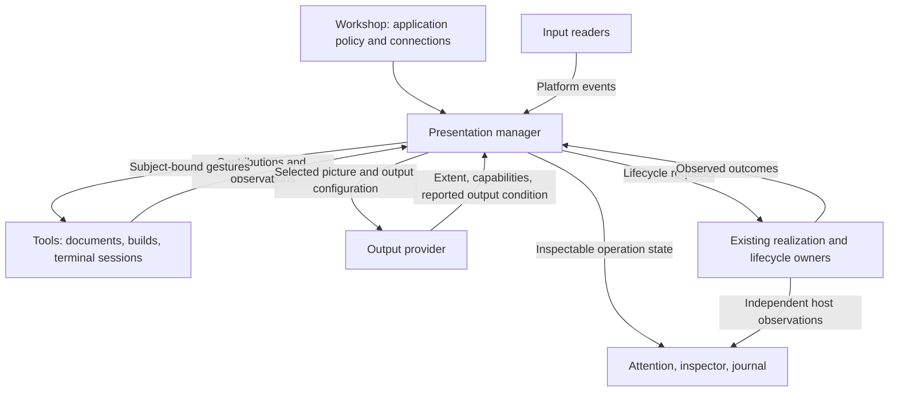

# Presentation as a managed service

**First draft for discussion — 2026-09-11.** This proposes ownership and observable behavior;
it selects no implementation, protocol version, new Loom facility or extraction scope.
The [source research](presentation-manager-research.md) separates current mechanisms from proposals.

The working bet: give presentation one understandable owner, built from the same material as
the tools it presents. Workshop supplies application policy and connects the participants.
The presentation manager turns their contributions into a coherent place to look and act.

## 1. What failure means here

A weave is allowed to be mistaken, silent, or permanently pending. A manager is also an authored
program and can be wrong. The architecture should make these behaviors attributable and give
other authorized participants useful ways to respond. It cannot promise correct authored code.

For Zengine, we aim to implement those responsibilities well: preserve work, tell the truth,
and make an unfinished operation inspectable. A refusal, a handler that failed, an output
provider's reported problem, and an unanswered request are different facts. Waiting is a valid
state; lack of progress is not evidence of its cause. Existing realization law already permits
an unanswered load to remain loading indefinitely. [E1](presentation-manager-research.md#e1-unanswered-work-and-existing-management)

External architecture supplies a place to observe, decide and recover. It need not make the
original operation succeed. Choosing another output provider may restore a useful Workshop
while the first provider's unfinished operation remains honestly unresolved.

## 2. Put these responsibilities together

“Presentation manager” names a responsibility, not a new mandatory base class, Kernel manager,
or the existing Pane Manager tool. My starting proposal is one application-facing service
owning composition and output selection, with separately testable layout, input and provider
lifecycle parts. Splitting source files and splitting authoritative owners are separate choices.

| Owner | Its authoritative facts |
|---|---|
| Workshop | Project intent, policy, grants, which services are connected, and allowed recovery choices |
| Presentation manager | Admitted contributions, arrangement, selection/focus, semantic input routing, active output binding, and its presentation operations |
| Tool weave | Its document, build, terminal session or other subject; what gestures mean and whether a requested change is admissible |
| Output provider | Its device/resources, actual extent and metrics, output capabilities, and what it can truthfully report about producing output |
| Input reader | Platform event capture and the units/source attached to those events |
| Lifecycle owner | Artifact admission, concrete participant identity and the lifecycle changes it actually performed |

A manager holds admitted projections with their origin and revision, not a second editable
copy of a tool's truth. A pane showing a build result still does not own the build. The current
“a presentation owns no facts” decision guards against that duplication; it does not forbid an
owner of arrangement, focus or output selection. [E2](presentation-manager-research.md#e2-where-presentation-lives-now)

The shipped Skins are already loadable weaves around native media. Here, “output provider”
names that service role; it is distinct from an artifact's operator-provider export. The new
work is managing the relationship, not making SDL into a weave for the first time.

Input capture and output remain independently composable. The manager decides where a gesture
goes; the recipient decides what it does. Swapping a renderer must not silently replace the
reader, reinterpret old coordinates using new metrics, or transfer a pending paste to another
document. The medium's clipboard and desktop facts remain medium-owned. [E3](presentation-manager-research.md#e3-media-input-and-resource-ownership)

## 3. Several truths, each named for what it establishes

The manager's authoritative presentation is the admitted logical picture and its interaction
state. Physical output is separately observed. A truthful record might say: “picture 42 is
selected; provider X last reported accepting picture 41; later output is unconfirmed.”

| Fact | What it establishes |
|---|---|
| Requested output | What the maker wants; it may differ from what is active |
| Loaded participant | Lifecycle admission succeeded; it says nothing by itself about usable graphics |
| Prepared output | This exact candidate reported meeting the stated preparation conditions for this operation |
| Active binding | The manager selected this provider for this particular surface |
| Submitted / acknowledged picture | A particular revision was sent / the provider made a defined claim about it |
| Observed failure | A named source reported a specific failure at a specific step |

An acknowledgment proves only its defined claim and provenance. A provider may claim it
submitted a frame to its platform; that is not proof that a person saw it. Devices with no
truthful acknowledgment can remain unconfirmed. The manager can preserve useful logical state
without claiming that frozen pixels are current.

This distinction is needed today: `SurfaceReady` is a greeting, emitted before the Skin calls
its medium. SDL initialization or later window creation can fail, and the diagnostic currently
goes to stderr. Neither the greeting nor the frame counter establishes successful output.
This needs an explicit manager-facing conversation if we want managed output transitions.
[E4](presentation-manager-research.md#e4-loaded-and-ready-do-not-establish-working-output)

## 4. Walk through changing output

Suppose a maker chooses output provider B while A is active.

1. The manager records the request and starts one identifiable transition. A continues serving
   if it remains viable. The existing lifecycle owner loads or prepares B under the host's
   authority; the manager does not acquire arbitrary loading power by being presentation code.
2. B is asked to prepare for a specified surface and picture revision. Its answer includes the
   capabilities and actual conditions relevant to selection. Candidate reports do not resize
   the active desk, take its input, publish over its picture, or seize its role merely by arriving.
3. The manager reconciles B's conditions with current logical presentation. A resize or edit
   during preparation can require a fresh candidate picture or a refusal. Recheck the relevant
   revision and exact participant at selection; an old ready answer cannot authorize new work.
4. The active output binding changes at an explicit selection event. Subsequent output and
   applicable input routing identify that binding. Late reports from the former binding
   remain attributable to it and cannot rewrite the new active state.
5. Retire A when the selected policy permits. If B subsequently fails, expose that new fact and
   decide recovery explicitly. Do not rewrite history as though selection never happened.

That is a proposed sequence, not a claim that today's role swaps implement it. Prepared
replacement offers useful participant/admission machinery; choosing where its role transition
and the manager's active binding agree remains a design obligation. [E5](presentation-manager-research.md#e5-lifecycle-boundaries-and-continuity)

There is a resource constraint: some candidates can prepare alongside the incumbent; others
need exclusive use of the same window, terminal or graphics resources. For the latter, the
manager must describe the required interruption or refuse a seamless switch. “Keep A until B
works” is conditional on that coexistence being possible. A sealed weave can still execute
native code and create resources; sealing is not a side-effect sandbox.

If B never answers, the transition may remain pending. Keep a bounded record and do not pile
up candidates automatically. A maker may choose another attempt if its admission and resource
policy allow it. Abandoning a wait does not retract an already-queued command. A superseded
attempt must not later select output or change the active binding; loading and resource
acquisition already underway retain their own outcomes and cleanup obligations. Retirement
and cleanup can remain unresolved too; capacity exhaustion should be an explicit refusal.

## 5. Make the unfinished work reachable

The manager needs an inspectable record for operations it owns: requested intent, initiating
participant, affected subject, target participant/artifact, current stage, outstanding attempt,
and the last observed outcome with its evidence source. Link child operations to their parent
intent explicitly. A bus dispatch parent is not a complete causal history of asynchronous work.
[E6](presentation-manager-research.md#e6-evidence-and-attribution)

An example of the maker-facing reading:

> Switching output to B — waiting for B to prepare a surface.
> A remains selected. B loaded successfully; no preparation outcome has been observed.
> Inspect this operation · inspect B · read available diagnostics.

If creation instead refuses, identify that step, the candidate and the reported reason. If
only a handler failure is known, name that observation without inventing its cause. Source
navigation should use actual artifact/source provenance where available; missing provenance
is an explicit gap, not a guessed file path.

This record is the manager's knowledge, not a transcript of everything in the system. Keep
bounded current state and route detailed history to existing facilities; distinguish expired
evidence from a known still-pending operation. Authenticated reports identify who said something,
not whether their internal implementation was correct.

A loaded manager cannot automatically read host-only observations. The host can expose a
scoped, authorized observation path using facts it already knows; the exact door remains to
be designed. Avoid granting the presenter an unrestricted copy of bus traffic just to explain
one failed transition. Keep a diagnostic route outside the failing output path: current
stderr and the journal are useful foundations, even when no pane can draw the explanation.

If the presentation manager itself fails, Workshop's host/lifecycle owner must be able to
observe that boundary independently. Replacing it should reconstruct what is actually known
about participants and current output; a saved selection or pending flag cannot prove a
provider is still active or revive an expired answer right. The precise recovery contract
remains open, alongside recovery of the output provider.

A silent handler that returns leaves the system able to run its manager. A native handler
that never returns can stall the shared thread, including that manager. External supervision
or process isolation is a different architectural choice; this draft promises neither.

## 6. What this changes about Editor opening

The manager can own revealing a pane, its admitted content, room and keyboard destination in
one place. This can remove coordination among several presentation decisions. It gives pending
opening and output failures a useful owner and explanation.

Editor still owns the current source. Moving presentation into a manager does not automatically
make Editor's source installation and the manager's view change together. The selected open
contract remains: successful opening has B installed, presented and focused at a defensible
boundary; refusal preserves A and causes no attributable setup/focus change. It is not being
redefined as speculative opening or eventual agreement in this draft.

Protected publication remains a candidate for that remaining boundary. First map which facts
must actually change together after these owners are placed. Use the research to test the
residual need, rather than using presentation extraction to force all weaves into root-backed
state. A permanently pending preparation is allowed; it must not hold unrelated admitted input
hostage or silently change the input's subject. [E7](presentation-manager-research.md#e7-editor-commitment-and-the-research-limit)

## 7. A small next exploration

Start with an owner model and a diagnostic slice, before a new SDK/ABI. Use an existing Skin
path to distinguish artifact refusal, medium preparation failure, selection and unanswered
preparation, with an operation record reachable outside the renderer. Then exercise candidate
resource coexistence, obsolete reports, and input associated with an old output binding. These are
proposed experiments, not authorization to implement the manager or extract another subsystem.

The first ordinary pane author should still supply content and handle its gestures. An output
provider author should learn a small preparation/output/reporting contract. Only authors who
need coordinated commitment should encounter that additional machinery. The ceremony check is
whether a novice can get from “my switch is stuck” to the relevant operation and participant
without understanding the entire architecture.

Three questions to brainstorm:

1. **The service boundary.** Is composition plus output selection the right initial manager,
   or should an output controller be independently replaceable from the start? My starting
   preference is one service with clear internal boundaries, split when a concrete consumer
   earns another owner. Avoid rebuilding the god-file under a new name.
2. **What selection promises.** Is a prepared compatible surface enough, with output progress
   separately reported, or should Zengine require a defined first-picture acknowledgment
   before declaring the switch complete? Either choice must describe an unconfirmed medium.
3. **Recovery authority.** Which recovery actions belong to Workshop's default policy, and which
   need a maker's explicit choice? My starting preference is to preserve viable current output,
   make interruption explicit, and keep an unresolved candidate from silently taking over later.

The stable principle is clear ownership and inspectable consequences. The mechanism and the
exact division of services are what this draft invites us to change.
